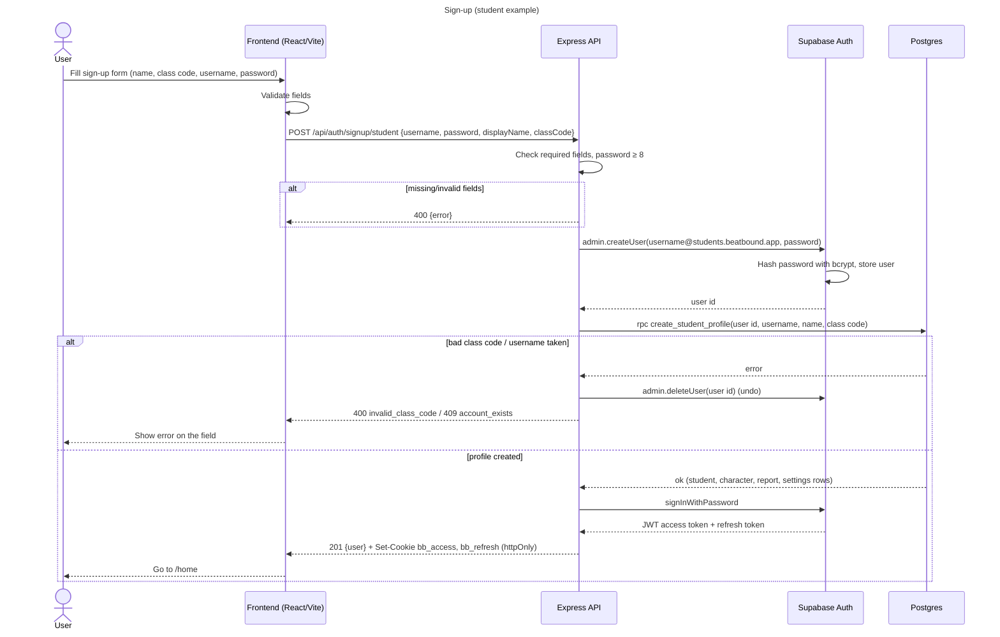
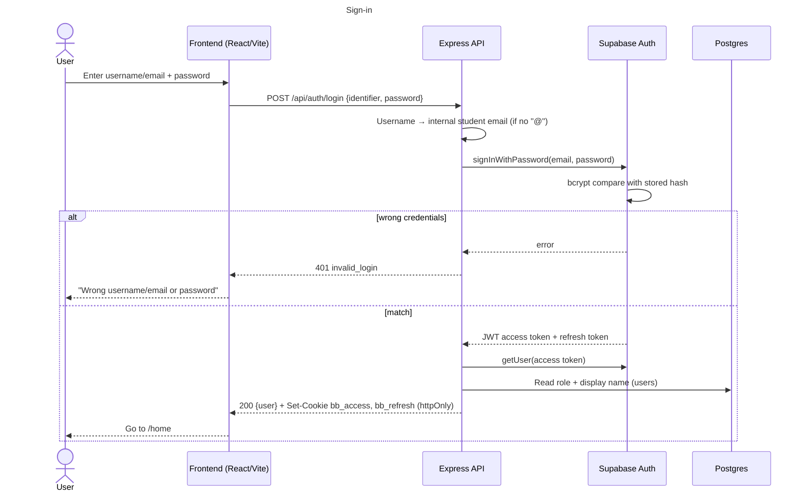
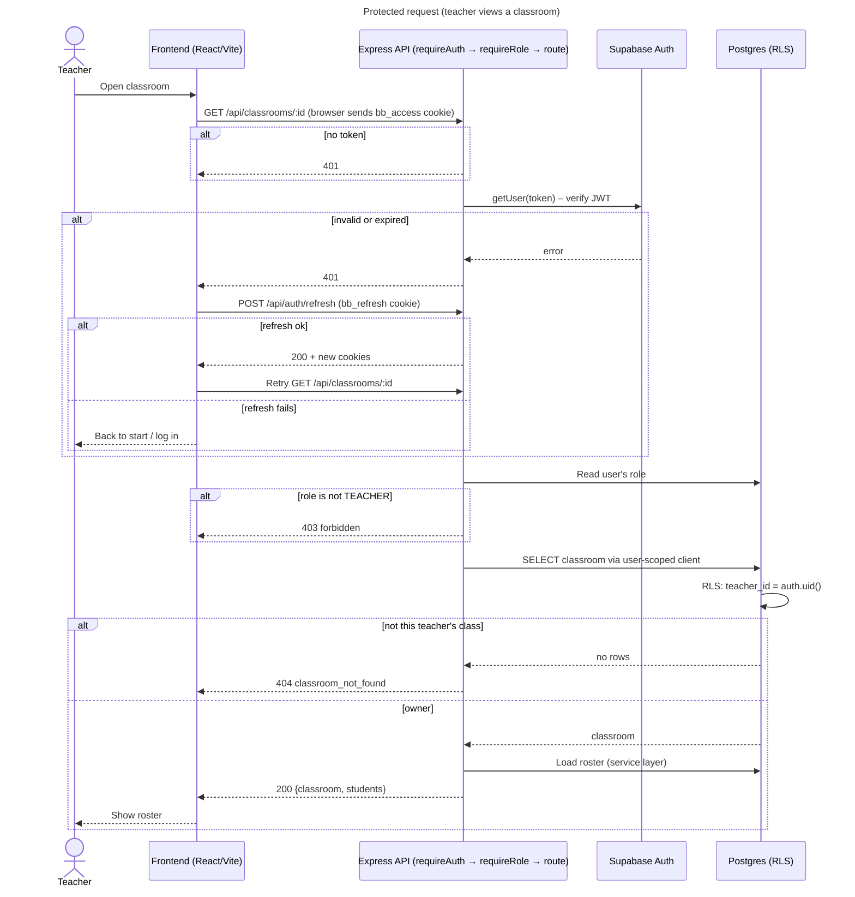

-- beatBound is an music learning environment for classrooms --
Lead Engineer: Amogh Arora; Scrum Master: Grigory Polunin; Product Owner: Edgar Olozagaste-Olea; Tester: All

## Running locally

- Backend: `cd packages/backend`, copy `.env.example` to `.env` and fill in `SUPABASE_URL`, `SUPABASE_SECRET_KEY`, and `SUPABASE_PUBLISHABLE_KEY`, then run `npm install` and `npm run dev` to start on `:4000`.
- Frontend: `cd packages/frontend`, run `npm install`, then `npm run dev` to start on `:3000`, which proxies `/api` to `:4000`.

## Access control (TE6)

This phase follows the class example for secure app access: passwords are hashed with bcrypt in Supabase Auth (never stored or sent in plain text, never in a URL); sign-in issues a signed JWT access token (short-lived) plus a refresh token; the tokens are sent as `httpOnly`, `SameSite=Lax` cookies (`Secure` in production) instead of local storage, so page JavaScript cannot read them (XSS protection). The backend also accepts `Authorization: Bearer ...`; `requireAuth` verifies the token on every protected request (401), `requireRole` checks the role (403), and Row Level Security in Postgres is a second check (each request uses a user-scoped DB client; the admin key is only used in `src/services/`). Students log in with a username (mapped to an internal email); teachers and parents use email. Sign-up and login are the only unprotected auth routes.

### Sequence diagrams

